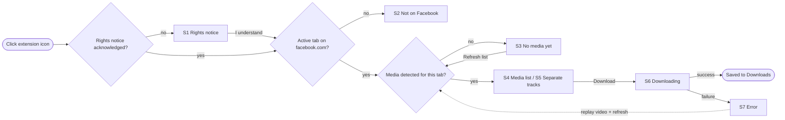

# Popup UX/UI and accessibility specification

| | |
|---|---|
| Status | **Draft** for review in #6 (workflow step 8) |
| Date | 2026-10-23 |
| Traces to | PRD #2 (`REQ-*`), threat model #3 (`THR-*`), media detection #5 (`ALG-*`), compliance #4 |
| Mockups | [`design/`](../design/README.md): one artboard per state, plus dark, English and store variants |

This document specifies the extension popup: every state, the elements on it (`UI-*`), the copy in English and Indonesian, accessibility behaviour, visual tokens, and the store screenshot plan. Requirement IDs refer to the **proposed** `REQ-*` table in #2 and become binding once `docs/PRD.md` is approved.

## 1. Scope and constraints

- **One purpose:** save the video the user is currently playing on `facebook.com`, one file per explicit click (`REQ-001`, `REQ-002`).
- **Popup only.** No options page, no content-script UI injected into Facebook, no badge counts that imply background collection.
- **Size:** 360 px wide; height grows with content up to 600 px (Chrome popups are capped at 800 × 600). The list scrolls inside the popup when it exceeds that.
- **Local only:** no remote fonts, images, or scripts. The popup uses `system-ui`; the mockups use Inter only as a stand-in (`REQ-004`, `THR-004`).
- **Untrusted strings** (page title, URL, file name) render through `textContent` only (`THR-003`).
- **No Facebook branding:** no Facebook logo or blue. The product accent is teal, so the extension is not mistaken for a Meta product.

## 2. Interaction flow

Mockup: [`design/Alur.dc.html`](../design/Alur.dc.html)



Every check runs when the popup opens or when the user presses **Refresh list**. Nothing runs in the background on the user's behalf (`REQ-002`). The **(i)** button in the header reopens the rights notice from any state.

## 3. States

Each state has a lo-fi sketch here and a full mockup in `design/`.

### S1 — Rights notice (first run)

Mockup: [`design/S1-Pemberitahuan.dc.html`](../design/S1-Pemberitahuan.dc.html) · `UI-001`, `UI-003`

```
┌──────────────────────────────────┐
│ [↓] AW Social Media Downloader   │
├──────────────────────────────────┤
│ (shield)                         │
│ Before you start                 │
│ Saves the video you are playing  │
│ on Facebook to Downloads.        │
│ ✓ Download only videos you own…  │
│ ✓ Session/cookies never read…    │
│ ✓ No telemetry, no server…       │
│                                  │
│ [        I understand        ]   │
│         Read privacy policy      │
├──────────────────────────────────┤
│ Powered by AhliWeb.com    v1.0.0 │
└──────────────────────────────────┘
```

- Shown once, before any other state. Acknowledgement is stored as a single boolean in `chrome.storage.local` (see §9, open question 3).
- Focus starts on **I understand**. The final wording waits for #4.

### S2 — Not on Facebook

Mockup: [`design/S2-BukanFacebook.dc.html`](../design/S2-BukanFacebook.dc.html) · `UI-002`, `UI-005`

```
│ Active tab · news.example.com    │
│        (browser + play icon)     │
│     Open a video on Facebook     │
│ Works only on Facebook video     │
│ pages: [Watch] [Reels] [Posts]   │
│     [ Open Facebook Watch ↗ ]    │
```

- The link opens `https://www.facebook.com/watch` in a new tab with `chrome.tabs.create`, which needs no `tabs` permission.

### S3 — No media yet

Mockup: [`design/S3-BelumAdaMedia.dc.html`](../design/S3-BelumAdaMedia.dc.html) · `UI-006`

```
│ facebook.com · Reels             │
│ <page title…>                    │
│ Play the video first             │
│ No media detected in this tab.   │  ← role="status"
│ (1) Play the video for a few s.  │
│ (2) Click Refresh list below.    │
│ ┌ Media is detected only after ┐ │
│ └ the browser loads it.        ┘ │
│ [ ⟳ Refresh list ]               │
```

### S4 — Media list (single files)

Mockup: [`design/S4-DaftarMedia.dc.html`](../design/S4-DaftarMedia.dc.html) · `UI-007`, `UI-008`

```
│ 2 media found                 ⟳  │  ← role="status"
│ ┌──────────────────────────────┐ │
│ │ [Single file · MP4] Best     │ │
│ │ 720p · 18.4 MB     [↓ Download]│
│ │ how-to-build-a-kite.mp4      │ │
│ └──────────────────────────────┘ │
│ ┌──────────────────────────────┐ │
│ │ [Single file · MP4]          │ │
│ │ 360p · 6.1 MB      [↓ Download]│
│ └──────────────────────────────┘ │
│ One click, one file…             │
```

- Sorted by quality, best first. The best row is highlighted and has the primary button; the others use secondary buttons.
- Size and quality appear only when known (from `Content-Length` or the request pattern in #5); otherwise the row shows the type alone.
- Each **Download** button's `aria-label` includes quality and size, for example "Download 720p, 18.4 MB".
- There is deliberately no "Download all".

### S5 — Separate video and audio tracks

Mockup: [`design/S5-TrekTerpisah.dc.html`](../design/S5-TrekTerpisah.dc.html) · `UI-009`

```
│ 2 tracks found                ⟳  │
│ ┌ ≋ This video is delivered as ┐ │
│ │ separate picture and sound   │ │
│ │ tracks. Download both, then  │ │
│ │ merge them in a video editor.│ │
│ └ How to merge tracks          ┘ │
│ [▭] Video only · no sound        │
│     1080p · 42.1 MB  [Download]  │
│ [♪] Audio only                   │
│     128 kbps · 3.2 MB [Download] │
│ A single combined file is not    │
│ available for this video.        │
```

- Shown only when no progressive file was observed: option **D, falling back to A**, as recommended in #5.
- Track type is conveyed by text and icon, never by colour alone.

### S6 — Downloading and done

Mockup: [`design/S6-Mengunduh.dc.html`](../design/S6-Mengunduh.dc.html) · `UI-010`

```
│ Downloading 720p… 64%            │  ← role="status" aria-live="polite"
│ ┌ 720p · 18.4 MB      [Cancel] ┐ │
│ │ 11.8 of 18.4 MB              │ │
│ └ ██████████████░░░░░░░        ┘ │  ← role="progressbar"
│ (✓) 360p · saved          [📁]   │  ← "Show in folder"
│ Downloads continue in Chrome's   │
│ download manager if you close…   │
```

- Progress comes from `chrome.downloads.onChanged`. **Cancel** calls `chrome.downloads.cancel` and **Show in folder** calls `chrome.downloads.show`.
- Announcements are throttled to every 25 % so screen readers are not flooded.

### S7 — Error

Mockup: [`design/S7-Galat.dc.html`](../design/S7-Galat.dc.html) · `UI-011`

```
│ ┌ ⚠ The media link has expired ┐ │  ← role="alert"
│ │ Facebook issues short-lived  │ │
│ │ links. Replay the video for a│ │
│ └ few seconds, then refresh.   ┘ │
│ [   ⟳ Refresh list   ]           │
│ Other errors                     │
│ Download refused — check …       │
│ Unknown error — try again; …     │
```

| Error | Trigger | Recovery |
|---|---|---|
| Expired link | HTTP 403/410 or a download `interrupted` with `SERVER_FORBIDDEN` / `SERVER_BAD_CONTENT` | Replay the video, then refresh |
| Download refused | `chrome.downloads.download` rejects, or `FILE_*` interrupt reasons | Check the Downloads folder (permissions, free space) |
| Unknown | Anything else | Retry; link to GitHub Issues |

### Variants

- **Dark mode:** [`design/S8-Gelap.dc.html`](../design/S8-Gelap.dc.html). Follows `prefers-color-scheme`; the mockup shows the keyboard focus ring.
- **English:** [`design/S9-English.dc.html`](../design/S9-English.dc.html). Shown when the browser UI language is not Indonesian.

## 4. UI elements → requirements

| ID | Element | Behaviour | Traces to | States |
|---|---|---|---|---|
| `UI-001` | Product header + **(i)** button | Product name; icon button with `aria-label` reopens the rights and privacy notice | `REQ-006`, `REQ-008` | all |
| `UI-002` | Tab context bar | Domain, surface type, page title; `textContent` only; ellipsis truncation | `REQ-001`, `THR-003` | S2–S7 |
| `UI-003` | First-run rights notice | Shown once; acknowledgement stored as one local boolean | `REQ-006`, `REQ-003` | S1 |
| `UI-004` | Footer rights strip | Rights sentence always visible + link to the packaged privacy policy | `REQ-006`, `REQ-004` | S2–S9 |
| `UI-005` | Not-on-Facebook state | Lists supported surfaces; opens Facebook Watch in a new tab | `REQ-001` | S2 |
| `UI-006` | No-media state | Two numbered steps + **Refresh list**; states that nothing is fetched in the background | `REQ-001`, `REQ-002` | S3 |
| `UI-007` | Media row | Type, quality, size when known, sanitized file name; best first | `REQ-001`, `REQ-005` | S4, S5 |
| `UI-008` | Per-row Download button | One file per click; descriptive `aria-label`; no bulk action | `REQ-002` | S4, S5 |
| `UI-009` | Separate-tracks panel | Shown only without a single file; merge guidance | `REQ-001`, `ALG-*` (#5) | S5 |
| `UI-010` | Progress and completion | `role="progressbar"` + polite live region; Cancel and Show in folder | `REQ-008` | S6 |
| `UI-011` | Error messages | `role="alert"`; every message carries a recovery step | `REQ-002`, `REQ-008` | S7 |
| `UI-012` | Localization | All strings through `chrome.i18n` (`_locales/en`, `_locales/id`) | `REQ-007` | S9 |
| `UI-013` | Light and dark theme | Paired colour tokens; AA contrast in both themes; focus ring always visible | `REQ-008` | S8 |

Every proposed `REQ-*` has at least one `UI-*` element. `REQ-003` and `REQ-004` are mainly enforced outside the UI (#5, #8); the UI only states them.

## 5. Copy table (`messages.json`)

| Key | English (`en`) | Bahasa Indonesia (`id`) |
|---|---|---|
| `appName` | AW Social Media Downloader | AW Social Media Downloader |
| `rightsTitle` | Before you start | Sebelum mulai |
| `rightsIntro` | Saves the video you are playing on Facebook to your Downloads folder. | Ekstensi ini menyimpan video yang sedang Anda putar di Facebook ke folder Unduhan. |
| `rightsNotice` | Download only content you own or have permission to download. | Unduh hanya konten milik Anda atau yang Anda punya izin untuk diunduh. |
| `privacyPromise` | Your session, cookies and tokens are never read, stored or sent. | Sesi, cookie, dan token Anda tidak pernah dibaca, disimpan, atau dikirim. |
| `localOnly` | No telemetry and no server — everything runs in your browser. | Tanpa telemetri dan tanpa server — semuanya berjalan di browser Anda. |
| `ackButton` | I understand | Saya mengerti |
| `privacyLink` | Privacy policy | Kebijakan privasi |
| `infoButtonLabel` | Rights and privacy info | Info hak dan privasi |
| `activeTab` | Active tab | Tab aktif |
| `notOnFacebookTitle` | Open a video on Facebook | Buka video di Facebook |
| `notOnFacebookBody` | This extension works only on Facebook video pages: | Ekstensi ini hanya bekerja di halaman video Facebook: |
| `surfaceWatch` · `surfaceReels` · `surfacePost` | Watch · Reels · Video in a post | Watch · Reels · Video di postingan |
| `openWatch` | Open Facebook Watch | Buka Facebook Watch |
| `noMediaTitle` | Play the video first | Putar videonya dulu |
| `noMediaStatus` | No media detected in this tab. | Belum ada media yang terdeteksi di tab ini. |
| `noMediaStep1` | Play the video in this tab for a few seconds. | Putar video di tab ini selama beberapa detik. |
| `noMediaStep2` | Click Refresh list below. | Klik Muat ulang daftar di bawah. |
| `noBackgroundFetch` | Media is detected only after the browser loads it for you. Nothing is fetched in the background. | Media hanya terdeteksi setelah browser memuatnya untuk Anda. Tidak ada pengambilan di latar belakang. |
| `refreshButton` | Refresh list | Muat ulang daftar |
| `mediaFound` | `$COUNT$` media found | `$COUNT$` media terdeteksi |
| `tracksFound` | `$COUNT$` tracks found | `$COUNT$` trek terdeteksi |
| `typeSingle` | Single file | Satu berkas |
| `typeVideoOnly` | Video only · no sound | Video saja · tanpa suara |
| `typeAudioOnly` | Audio only | Audio saja |
| `bestBadge` | Best | Terbaik |
| `downloadButton` | Download | Unduh |
| `downloadLabel` | Download `$QUALITY$`, `$SIZE$` | Unduh `$QUALITY$`, `$SIZE$` |
| `oneClickHint` | One click, one file. The file name comes from the page title, made safe for every operating system. | Satu klik, satu berkas. Nama berkas diambil dari judul halaman dan disesuaikan agar aman untuk semua sistem operasi. |
| `tracksExplainer` | This video is delivered as separate picture and sound tracks. Download both, then merge them in a video editor. | Video ini dikirim dalam trek gambar dan suara terpisah. Unduh keduanya, lalu gabungkan di aplikasi penyunting video. |
| `mergeHowTo` | How to merge tracks | Cara menggabungkan trek |
| `noSingleFile` | A single combined file is not available for this video. | Berkas tunggal (gambar + suara) tidak tersedia untuk video ini. |
| `downloading` | Downloading `$QUALITY$`… `$PERCENT$`% | Mengunduh `$QUALITY$`… `$PERCENT$`% |
| `downloadProgress` | `$DONE$` of `$TOTAL$` | `$DONE$` dari `$TOTAL$` |
| `cancelButton` | Cancel | Batal |
| `savedLabel` | `$QUALITY$` · saved | `$QUALITY$` · tersimpan |
| `showInFolder` | Show in folder | Tampilkan di folder |
| `continuesHint` | Downloads continue in Chrome's download manager even if you close this popup. | Unduhan berjalan lewat pengelola unduhan Chrome dan tetap lanjut meski popup ditutup. |
| `errorExpiredTitle` | The media link has expired | Tautan media sudah kedaluwarsa |
| `errorExpiredBody` | Facebook issues short-lived links. Replay the video for a few seconds, then refresh the list. | Facebook hanya memberi tautan berumur pendek. Putar ulang video beberapa detik, lalu muat ulang daftar. |
| `errorRefused` | The browser refused the download. Check your Downloads folder. | Unduhan ditolak browser. Periksa izin dan ruang folder Unduhan. |
| `errorUnknown` | Something went wrong. Try again; if it keeps happening, report it. | Terjadi kesalahan. Coba lagi; bila berulang, laporkan masalah. |
| `poweredBy` | Powered by AhliWeb.com | Powered by AhliWeb.com |

#15 enforces identical key sets in both locales with a unit test. `rightsNotice`, `rightsIntro` and the store listing copy are **provisional until #4** records the owner decision.

## 6. Accessibility (`REQ-008`, WCAG 2.2 AA)

1. **Focus order:** (i) → Refresh list → Download row 1…n → Privacy policy. Initial focus goes to the state's primary action.
2. **Native controls only:** `<button>` and `<a href>`. Icon-only buttons carry `aria-label`; decorative SVGs carry `aria-hidden="true"`.
3. **Announcements:** state changes go through `role="status"` / `aria-live="polite"`, and errors through `role="alert"`. Progress announcements are throttled.
4. **Focus ring:** 2 px solid, 2 px offset, accent colour; never removed.
5. **Targets:** at least 44 × 44 px, which exceeds the WCAG 2.2 SC 2.5.8 minimum of 24 × 24.
6. **Contrast:** measured values are in §7, and every text pair passes 4.5:1.
7. **Not colour alone:** track type, best quality and error state are always paired with text or an icon.
8. **Motion:** the progress-bar transition is disabled under `prefers-reduced-motion`.
9. **Language:** set `<html lang>` from `chrome.i18n.getUILanguage()`.

## 7. Visual tokens

| Token | Light | Dark | Contrast (text on its background) |
|---|---|---|---|
| Background | `#FFFFFF` | `#111827` | — |
| Surface / context bar | `#F9FAFB` | `#1F2937` | — |
| Text | `#111827` | `#F9FAFB` | 17.74 : 1 / 16.98 : 1 |
| Secondary text | `#4B5563` | `#D1D5DB` | 7.56 : 1 / 12.04 : 1 |
| Accent / primary button | `#0F766E` (white text) | `#2DD4BF` (`#042F2E` text) | 5.47 : 1 / 7.77 : 1 |
| Accent text on tint | `#115E59` on `#CCFBF1` | `#CCFBF1` on `#115E59` | 6.73 : 1 |
| Focus ring and links | `#0F766E` | `#5EEAD4` | 5.47 : 1 / 11.99 : 1 |
| Error text on tint | `#7C2D12` on `#FFF7ED` | — | 8.83 : 1 |
| Info text on tint | `#1E3A8A` on `#EFF6FF` | — | 9.52 : 1 |
| Border | `#E5E7EB` | `#374151` | — |

- **Type:** `system-ui`. Sizes are 18/24 (state title), 15/20 (product name, list title), 14/20 (body, buttons), 12/17 (meta, footer), and 11 monospace (file names).
- **Spacing:** 16 px gutter; 8 / 12 / 16 px gaps.
- **Radius:** 8 px for buttons, 10 px for cards, pill for chips.
- **Icons:** inline 2 px stroke SVG, bundled; no icon font.

## 8. Store screenshot plan (1280 × 800, for #18)

| # | Content | Purpose |
|---|---|---|
| 1 | Media list over a Reels page ([`design/Toko-Screenshot.dc.html`](../design/Toko-Screenshot.dc.html)) | Core value |
| 2 | Separate tracks + merge guidance | Honest about limits |
| 3 | Privacy promise: no telemetry, no server, session never read | Trust |
| 4 | Rights notice | Shows CWS policy compliance |
| 5 | Dark mode + English | Accessibility and bilingual support |

All screenshots must use the owner's own test video. The listing language waits for #4.

## 9. Open questions (resolve before gate 9, #7)

1. **Listing and notice wording** depend on the #4 owner decision.
2. **`REQ-007` vs #15:** #2 requires English and Indonesian UI in v1.0.0, but #15 (localization) is P2 and "does not block v1.0.0". Either raise #15 to P1 or move `REQ-007` after 1.0. This spec assumes both locales ship.
3. **Stored acknowledgement flag:** `UI-003` stores one boolean in `chrome.storage.local`, and the requested data-inventory rule is that nothing is persisted. #3 must list this flag (non-personal, no retention concern) or the notice must reappear every time.
4. **Size and quality labels:** whether these are reliably available depends on the #5 investigation. If they are not, rows show the type only.
5. **Priority of #6:** this spec blocks gate 9 (#7) and therefore all P0 implementation, so #6 should be P0 rather than P1.

## 10. Related standards

- **WCAG 2.2** (W3C Recommendation): target of `REQ-008`. ISO/IEC 40500:2012 is the ISO publication of WCAG 2.0 only.
- **ISO 9241-110:2020** (interaction principles) and **ISO 9241-171:2008** (software accessibility): self-descriptiveness, error tolerance, and controllability guided the state and error design.
- **ISO/IEC 27002:2022 8.26 / 8.28:** application security requirements and secure coding. Applied through `textContent` rendering and the absence of remote code.

## References

- PRD: #2 · Threat model: #3 · Compliance: #4 · Media detection: #5 · Gate 9: #7 · Popup implementation: #14 · Localization: #15
- Chrome extension popups: https://developer.chrome.com/docs/extensions/develop/ui/add-popup
- `chrome.i18n`: https://developer.chrome.com/docs/extensions/reference/api/i18n
- `chrome.downloads`: https://developer.chrome.com/docs/extensions/reference/api/downloads
- WCAG 2.2: https://www.w3.org/TR/WCAG22/
- AW Browser Cleaner accessibility work: ahliweb/chrome-awbrowsercleaner#10
